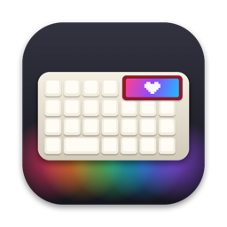
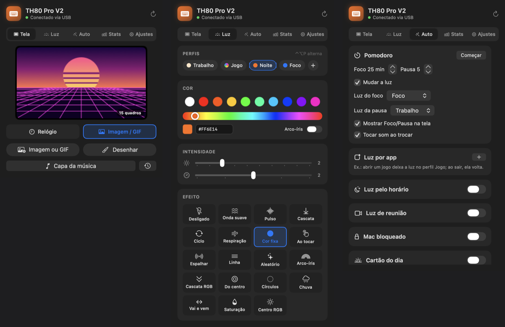
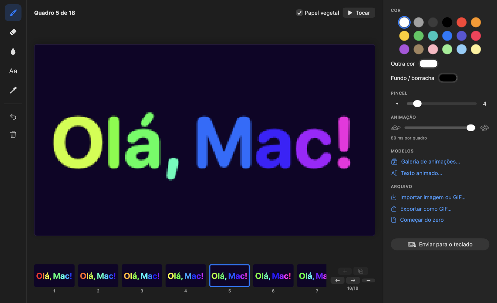
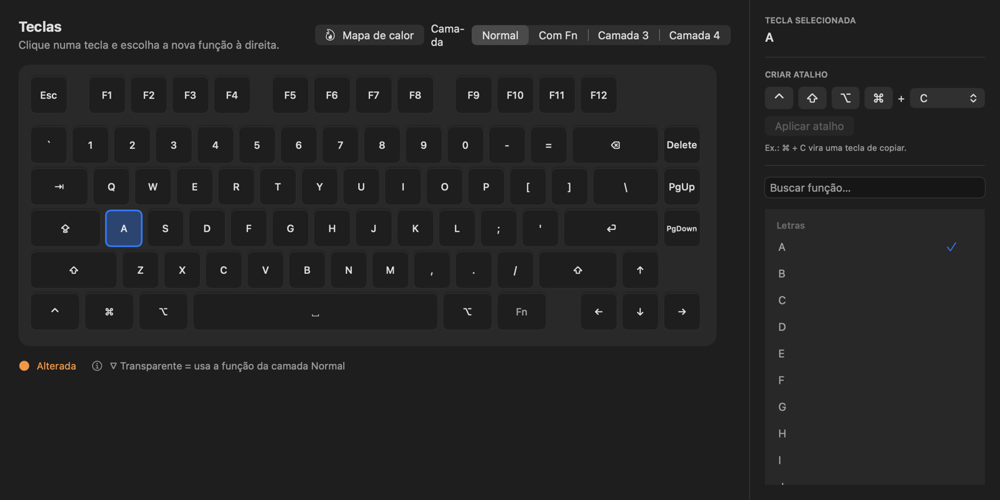
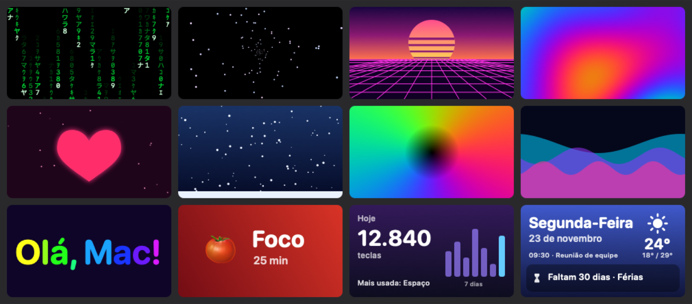

<p align="center">
  
</p>

<h1 align="center">TH80 Bar</h1>

<p align="center">
  App nativo de barra de menu para macOS que controla a <b>tela</b>, a <b>luz RGB</b> e as <b>teclas</b> do teclado
  <b>EPOMAKER TH80 Pro V2</b>, sem precisar do Windows.
</p>

---

O software oficial da EPOMAKER para a tela e a iluminação do TH80 Pro V2 só existe para Windows. Quem usa Mac fica
sem trocar a imagem da telinha, sem mudar a cor da luz pelo computador e sem remapear as teclas. O TH80 Bar resolve isso
com um app leve que fica na barra de cima do macOS e conversa direto com o teclado pelo USB.



## O que ele faz

**Tela**
- Envia imagens e GIFs (redimensionados automaticamente para 240 × 135, até 18 quadros)
- Editor de desenho com animação: pincel, borracha, balde, texto, conta-gotas, quadros, papel vegetal, prévia e exportação em GIF
- Galeria com 8 animações prontas (chuva digital, synthwave, plasma, neve…) e gerador de texto animado (máquina de escrever, letreiro, arco-íris)
- Cartão do dia: data, clima (Open-Meteo), próximo compromisso do Calendário e contagem regressiva
- Capa da música que está tocando no Spotify ou no app Música

**Luz**
- Cor (paleta, faixa de matiz e HEX), brilho, velocidade e 19 efeitos
- Perfis com um clique e atalho global <kbd>⌃</kbd><kbd>⌥</kbd><kbd>P</kbd> para alternar entre eles
- Automações: luz por horário (dia/noite), luz de reunião quando a câmera ou o microfone ligam, luz por app, apagar ao bloquear o Mac
- Pomodoro com troca de luz e telas de Foco/Pausa, e contador na barra de menu

**Teclas**
- Remapeamento das 4 camadas pelo protocolo VIA, com criação de atalhos (ex.: <kbd>⌘</kbd>+<kbd>C</kbd> numa tecla só)
- Backup automático do mapa original e botão para restaurar tudo
- Estatísticas de digitação com mapa de calor do teclado (conta só quantas vezes cada tecla é apertada, nunca o texto)

**Outros**
- Backup e importação de todas as configurações num arquivo só
- Interface em português

| Editor de desenho | Remapeamento de teclas |
| --- | --- |
|  |  |



## ⚠️ Antes de enviar a primeira imagem

**Enviar uma imagem ou GIF apaga toda a memória de imagens do teclado**, inclusive:

- a **animação de fábrica**, e
- **os números do relógio** da tela. Depois disso, o modo relógio mostra só o fundo e os dois-pontos.

Isso acontece porque o comando de gravação do próprio teclado limpa toda a área de imagens antes de gravar, e os
desenhos dos dígitos ficam numa área que não dá para regravar por USB. Até onde se sabe, só a EPOMAKER consegue
restaurar esses recursos. Se o relógio é importante para você, **não envie imagens**. A luz, as teclas e as automações
de luz não mexem nessa memória.

## Instalação

### Opção 1: baixar pronto

1. Baixe o `TH80-Bar.zip` em [Releases](../../releases) e descompacte.
2. Mova o **TH80 Bar.app** para a pasta Aplicativos.
3. O app não é assinado pela Apple, então o macOS bloqueia na primeira vez. Rode no Terminal:
   ```bash
   xattr -dr com.apple.quarantine "/Applications/TH80 Bar.app"
   ```
4. Abra o app. O ícone de teclado aparece na barra de menu.

### Opção 2: compilar

Precisa do macOS 14 ou superior e das Ferramentas de Linha de Comando do Xcode (`xcode-select --install`).

```bash
git clone https://github.com/WendelJunior03/th80-bar.git
cd th80-bar
./build.sh        # compila e instala em ~/Applications/TH80 Bar.app
open ~/Applications/"TH80 Bar.app"
```

## Uso

- Conecte o teclado **pelo cabo USB**. Por Bluetooth o teclado não expõe o canal da tela e da luz.
- Feche o VIA e outros configuradores enquanto usa o app.
- Algumas funções pedem permissão do macOS na primeira vez:
  - **Monitoramento de Entrada**: só para as estatísticas de digitação
  - **Calendário**: só se o cartão do dia mostrar compromissos
  - **Automação** (Spotify/Música): só para a capa da música

## Como funciona

O TH80 Pro V2 (USB `320F:5055`) expõe duas interfaces HID além do teclado:

| Interface | Usage page | Uso |
| --- | --- | --- |
| Proprietária | `0xFF1C` / `0x92`, report ID 4 | Tela, iluminação e relógio. Pacotes de 64 bytes com checksum de 16 bits; bloco de configuração de 48 bytes; imagens em RGB565 de 64 KiB por quadro |
| VIA | `0xFF60` / `0x61`, report ID 0 | Mapa de teclas (protocolo VIA v9, 4 camadas, matriz 8 × 16) |

O app é escrito em Swift/SwiftUI e fala com o teclado via `IOHIDManager`, sem drivers nem dependências externas.
Cada gravação de configuração lê o estado atual antes e só altera os campos necessários.

O que foi descoberto testando no Mac:

- As respostas da interface proprietária chegam com 8 bytes no macOS.
- O teclado aceita gravar imagens até o endereço `0xFE0000` e recusa a área reservada dos últimos 128 KB.
- Os efeitos de luz usam os mesmos IDs da família GMK87, mas os nomes podem variar no TH80.

## Estrutura

```
Sources/TH80Bar/
  HIDDevice.swift        transporte HID (thread com run loop, transações síncronas)
  Protocol.swift         pacotes da tela/luz, bloco de configuração, envio de imagens
  Keymap.swift           cliente VIA, catálogo de teclas, backup do mapa original
  KeyboardModel.swift    estado do app e motor de automações
  ScreenArt.swift        galeria, texto animado, cartões (dia, Pomodoro, música, estatísticas)
  Editor*.swift          editor de desenho e animação
  TypingStats.swift      contagem de teclas (CGEventTap só de escuta)
tools/make_icon.swift    gera o ícone do app
```

## Créditos

- O protocolo da tela e da iluminação foi adaptado do [th80-studio](https://github.com/Clouddios/th80-studio), de
  Clouddios (licença MIT), que fez a engenharia reversa original no Windows. O layout das teclas vem da definição VIA
  incluída nesse projeto.
- Referências da mesma família de protocolo: [gmk87-node](https://github.com/codedgar/gmk87-node) e
  [th80screen-control](https://github.com/janatii/th80screen-control).
- Clima: [Open-Meteo](https://open-meteo.com).

Veja [THIRD_PARTY_NOTICES.md](THIRD_PARTY_NOTICES.md).

## Aviso

Projeto independente, sem vínculo com a EPOMAKER. Use por sua conta e risco. EPOMAKER e TH80 são marcas de seus
respectivos donos.

## Licença

[MIT](LICENSE)
